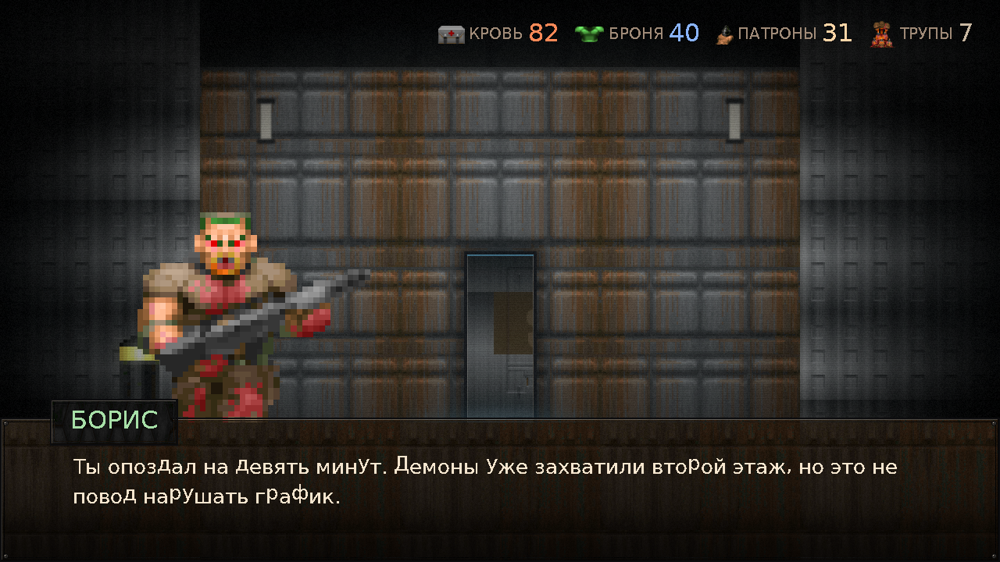
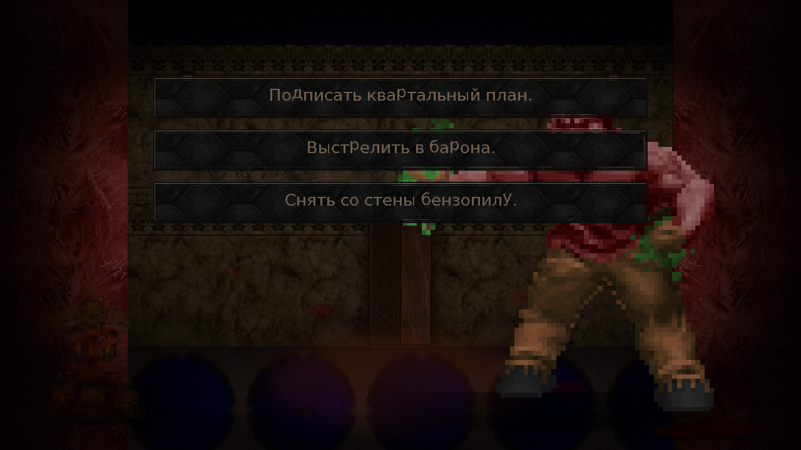
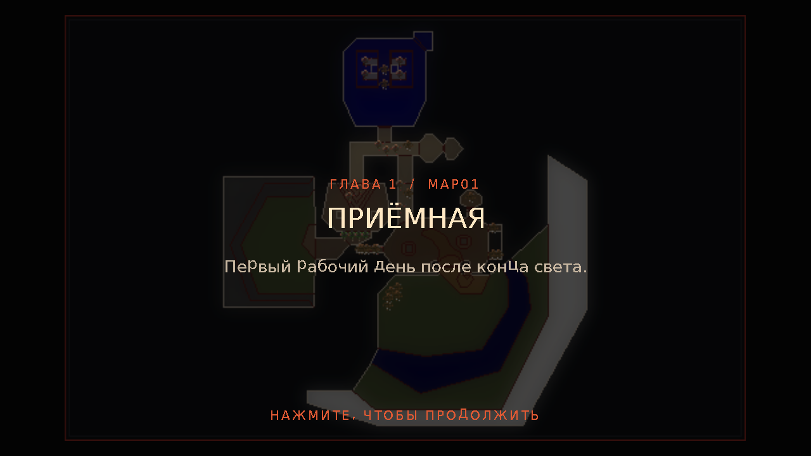

# DOOM: Испытательный срок

[](https://github.com/dpteam/DOOM_Novell/actions/workflows/ci.yml)
[](https://github.com/dpteam/DOOM_Novell/releases)
[](LICENSE)

> «Ад — это не место. Это график.»

Фанатская **визуальная новелла** на Ren'Py в декорациях DOOM II: корпоративная
сатира, чёрный юмор и очень уставший сержант, которому нужно дожить до конца
рабочего дня и не подписать лишнюю бумагу.

Все ресурсы — фоны, спрайты, интерфейс, шрифты, звуки и музыка — **извлечены
из IWAD** (`DOOM2.WAD` или `FREEDOOM2.WAD`) скриптами из `tools/`. В репозитории
нет ни одной картинки, нарисованной в графическом редакторе.



| Выбор | Карточка главы |
| --- | --- |
|  |  |

---

## Что это

Сержант — единственный, кто остался в отделе ликвидации биологических угроз
после сокращения. Демоны захватили второй этаж и выдвинули требования:
коллективный договор, кофемашина и запрет на внезапные телепорты в рабочее
время. Сержанту нужно пройти пять этажей бюрократического ада, по пути
разговаривая с эйчаром-какодемоном, коучем-архивилем и директором-кибердемоном.

- **5 глав**, 375 реплик, ~3 200 слов.
- **7 выборов**, которые считают фраги, милосердие и обещания.
- **6 концовок**, включая секретную (бензопила).
- **HUD** с HP, бронёй, патронами и счётчиком трупов.
- **Архив**: концовки, бестиарий и все 32 плана уровней DOOM II — тоже
  отрисованные из настоящей геометрии WAD.

## Особенности реализации

- **Ни одного внешнего ассета.** Палитра, `COLORMAP`, патчи, текстуры
  `TEXTURE1`, флэты, спрайты, `STCFN`-шрифт, DMX-звуки, MUS-музыка и
  `VERTEXES/LINEDEFS/SECTORS` — всё читается из WAD на чистом Python.
- **Музыка синтезируется.** MUS разбирается в события и рендерится
  аддитивным синтезатором на numpy (звучит как звуковая карта 1994 года).
- **Пиксельный шрифт с кириллицей.** В DOOM нет кириллицы, поэтому глифы
  растрируются из DejaVu Sans в 1-битном режиме и упаковываются в BMFont.
- **Совместимость с FreeDoom.** `python tools/build_assets.py --iwad freedoom2.wad`
  — и получается другая игра, которую можно распространять.

## Быстрый старт

```bash
# 1. Установить движок (Windows, через Scoop)
scoop install renpy

# 2. Запустить
renpy "C:\path\to\DOOM_Novell"

# 3. Пересобрать ассеты из своего WAD
python -m pip install -r requirements.txt
python tools/build_assets.py --iwad DOOM2.WAD --out .
python tools/gen_images_rpy.py
```

Проверка проекта:

```bash
renpy "C:\path\to\DOOM_Novell" lint
# 375 dialogue blocks, 148 images, 36 screens. Без ошибок.

renpy "C:\path\to\DOOM_Novell" test smoke
# Прогоняет меню и всю игру до концовки. Status: PASSED.
```

Если игра запускается с чёрным экраном — в диалоге выбора рендерера выберите
**Force ANGLE2** (на некоторых удалённых/виртуальных машинах нет OpenGL).

## Управление

| Действие | Клавиша |
| --- | --- |
| Дальше | ЛКМ / Enter / Space |
| Пропуск | Ctrl (удерживать) или кнопка «ПРОПУСК» |
| История | кнопка «ИСТОРИЯ» |
| Архив | кнопка «АРХИВ» в меню |
| Меню | Esc / ПКМ |

## Структура

```
game/
  script.rpy            старт и карточки глав
  story/                5 глав + концовки
  characters.rpy        персонажи, состояние, хелперы (фраги, урон, обещания)
  theme.rpy             стили: шрифты, панели, цвета, трансформы
  screens.rpy           базовая GUI Ren'Py (перекрашена)
  screens_custom.rpy    HUD, карточки глав, архив, бестиарий, итоги
  fonts.rpy             регистрация bitmap-шрифтов из fonts.json
  images/  gui/  audio/  fonts/   ← всё сгенерировано из IWAD
  wad_manifest.json     откуда что взялось (SHA-256 IWAD, счётчики)
tools/
  build_assets.py       конвейер: IWAD → game/
  wadlib/               чтение WAD, звук, уровни, композит, шрифты
  gen_images_rpy.py     генерирует game/images.rpy
docs/
  ASSETS.md             полная карта «lump → ассет»
  ARCHITECTURE.md       устройство конвейера и игры
  STORY.md              сценарий и концовки (спойлеры)
  BUILD.md              сборка, упаковка, типичные проблемы
```

## Документация

- [`docs/ASSETS.md`](docs/ASSETS.md) — что из какого lump'а получается.
- [`docs/ARCHITECTURE.md`](docs/ARCHITECTURE.md) — как устроен конвейер и игра.
- [`docs/STORY.md`](docs/STORY.md) — главы, флаги и все концовки.
- [`docs/BUILD.md`](docs/BUILD.md) — запуск, упаковка, пересборка, траблшутинг.
- [`docs/CI.md`](docs/CI.md) — что делает GitHub Actions и как выпустить релиз.
- [`docs/CHANGELOG.md`](docs/CHANGELOG.md) — история решений (включая пару
  поучительных багов).

## Готовые сборки

Теги собираются автоматически и публикуются в
[Releases](https://github.com/dpteam/DOOM_Novell/releases): Windows (zip),
Linux (tar.bz2) и macOS (zip). Каждый коммит в `main` дополнительно оставляет
win/linux/mac-архивы в артефактах CI на 14 дней.

Релиз выпускается одним тегом:

```bash
git tag v1.1.0
git push origin v1.1.0
```

## Лицензии

- Код, конвейер и документация — **MIT** (см. `LICENSE`).
- Графика и звук — **id Software / ZeniMax**, используются как фанатская
  некоммерческая переработка. Для публикации сборки пересоберите ассеты из
  **FreeDoom** — см. `docs/ASSETS.md`.
- Ren'Py — MIT, © Tom Rothamel и участники; в репозиторий не входит.
- Кириллические шрифты — растрированные глифы **DejaVu Sans** (Bitstream Vera).

Проект не связан с id Software, Bethesda или ZeniMax. `DOOM` — торговая марка
id Software. Никакой коммерческой выгоды здесь нет и не планируется.

---

*RIP AND TEAR. Но сначала заполните форму 4-П.*